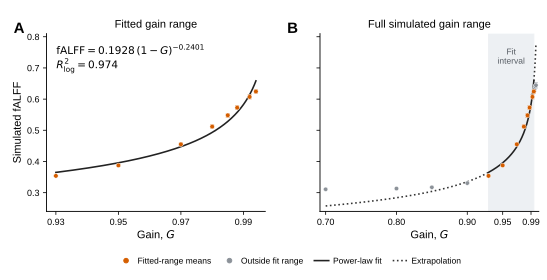

# Human Connectome Project (HCP) Distance to Criticality (DTC)

`hcp_dtc` contains analysis and modeling code for studying spatial variation in distance to criticality (DTC) across the human cortex using large-scale resting-state fMRI data. The repository combines empirical analyses of HCP-derived measures, including fALFF and rFCD, with random recurrent rate-model simulations used to infer cortical proximity to dynamical transitions.

The project builds on modeling ideas developed in [`critical_slowing_down_in_free_recall`](https://github.com/dovi-yellin/critical_slowing_down_in_free_recall), but this repository is organized around the HCP cortical DTC manuscript and its associated analysis scripts. The central goal is to quantify heterogeneous cortical DTC and compare empirical fMRI dynamics with network simulations.

## Overview

- `scripts/` - Main analysis and figure-generation entry points.
- `infrastructure/` - Support code used by the scripts.
- `data/` - Local input data and precomputed intermediate files used by the analysis scripts. Large HCP-derived data products are not intended to be committed to Git.
- `results/` - Local generated outputs, cached analysis products, and figures.
- `figures/` - Local figure output from model simulations and exploratory analyses.
- `tests/` - Lightweight import smoke tests for the current transitional package layout.

For a standalone first run, reproduce Supplementary Figure S3 from the small simulation-only summaries included in this repository; no HCP files are needed. See the instructions below.

## Infrastructure

The `infrastructure/` folder contains shared support code used by the analysis scripts. Most users should interact with the project through the scripts and generated figures rather than calling infrastructure modules directly.

## Manuscript Figure Generation

Several manuscript figures are generated by the current analysis scripts:

| Script | Manuscript output |
|---|---|
| `scripts/fig_2_emprical_vs_simulated_TCs.py` | Fig. 2 time-course comparison panels |
| `scripts/HCP_criticality_markers_analysis.py` | Fig. 3, all panels; Fig. 4A and Fig. 4E; Fig. 6, all panels; Supplementary Fig. S1, all panels; Supplementary Fig. S2; Supplementary Fig. S7 |
| `scripts/make_figure_5.py` | Fig. 5, all panels |
| `scripts/make_figure_S3.py` | Revised Supplementary Fig. S3, both panels; tau = 120 ms |
| `scripts/make_figure_S5.py` | Supplementary Fig. S5, all panels |

Except for Figure S3, these scripts load precomputed subject-level criticality marker, tSNR, PSD, and FCD files from `data/`, and some scripts also read simulation outputs from `results/`. Those workflows need the required local data products before they can run end to end.

Figures 5 and S5 additionally require the demean regional PSD tensor `data/all_subjects_all_rois_psd_tensor_raw_centered.pickle`. Build it once from the per-subject time-course pickles with `python scripts/build_regional_psd_tensor.py`, then run the figure scripts.

### Supplementary Figure S3



The revised S3 uses the verified stationary simulation ensemble with tau = 120 ms, N = 400, p = 0.2 and the 1.3-second effective observation filter. Panel A shows the existing finite-range power-law fit; panel B shows all simulated gain levels and explicitly marks extrapolation of that same fit. Error bars are SEM across 14 realization means, each averaging four observation windows.

Use Python 3.11 or later (verified with 3.12.10), install the small figure-specific environment and generate the figure:

```bash
python -m pip install -r requirements-figure-S3.txt
python scripts/make_figure_S3.py
```

The default output is `figures/figure_S3/`: PNG, vector PDF, editable-text SVG, caption, source-data table and verification JSON. Use `--output-dir PATH` to choose another directory or `--formats png,svg` to select formats. Paths are resolved relative to the script, so it also runs from another working directory. Python 3.12.10 was used for the reviewed export; the figure-specific dependency file pins NumPy and Matplotlib. Font availability can change rendering across operating systems; the data and numerical fit are verified independently of fonts.

The 210 bundled rows in `data/figure_S3/` contain simulation means only (14 realizations x 15 gains), with checksums and provenance. The replay verifies the existing fit, **fALFF = 0.1928 (1 - G)^(-0.2401)**, log-space R² = 0.974, using only G' = 0.006–0.07. It does not run simulations, load participant data or change the cortical-map calibration. This stationary ensemble differs from the three-fresh-realization display in main Figure 4C. Read the [figure caption](docs/figure_S3_caption.md) for the sampling and interpretation.

Run the S3 numerical and standalone-replay checks in this minimal environment with:

```bash
python -m unittest discover -s tests -p test_figure_S3.py -v
```

The complete test suite (`python -m unittest discover -s tests -v`) also runs the existing infrastructure import smoke tests, which require the full repository dependencies in `requirements.txt`.

## How To Install

Clone this repository and install dependencies:

```bash
git clone https://github.com/dovi-yellin/hcp_dtc.git
cd hcp_dtc
```

We recommend using a virtual environment:

```bash
python -m venv venv
source venv/bin/activate
pip install -r requirements.txt
```

## Getting Started

Start with the self-contained Figure S3 replay above or the manuscript figure table and analysis entry points in `scripts/`. Other manuscript scripts assume that the expected HCP-derived local data files are already present under `data/`.

The S3 workflow plots existing simulation summaries. A standalone workflow that runs a new recurrent-network simulation remains future work; an example can be adapted from the related [`critical_slowing_down_in_free_recall` examples](https://github.com/dovi-yellin/critical_slowing_down_in_free_recall/tree/main/examples).

## Citation to related Project

```bibtex
@article{yellin2026hcp_dtc,
  title={A cortical gradient of distance to criticality governs large-scale resting-state fMRI dynamics},
  authors={Yellin, D. and Simony, E. and Malach, R. and Shriki, O.},
  journal={bioRxiv},
  year={2026},
  doi={10.64898/2026.05.21.726898}
}
```
